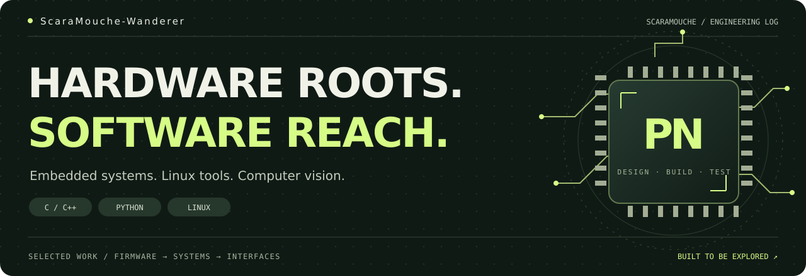
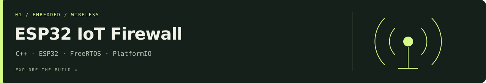
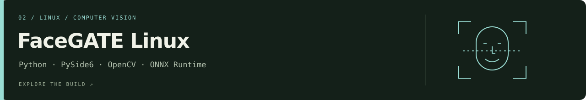
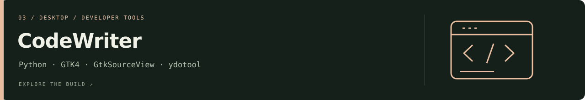

  

  <a href="#selected-builds">Selected builds</a> &nbsp; / &nbsp;
  <a href="./PROJECTS.md">Project index</a> &nbsp; / &nbsp;
  <a href="#engineering-toolkit">Toolkit</a>

I'm **Prathmesh Narwaria**, also known as **ScaraMouche**. I build across the boundary between hardware and software: ESP32 firmware, Linux desktop tools, and local computer vision.

My projects connect low-level behavior to interfaces you can inspect, test, and demonstrate.

## Selected builds

### 01 / ESP32 IoT Firewall

An ESP32 wireless intrusion detection project with a packet-processing pipeline, rule-based detectors, alert lifecycles, and a Web Serial dashboard.

**Engineering focus:** queue-based processing, bounded device tracking, native host tests, and a laptop demo with explicitly simulated telemetry.

[Source](https://github.com/ScaraMouche-Wanderer/Iot-Firewall-main) · [Project brief](https://github.com/ScaraMouche-Wanderer/Iot-Firewall-main/blob/main/PROJECT_BRIEF.md) · [Run the demo](https://github.com/ScaraMouche-Wanderer/Iot-Firewall-main/blob/main/docs/PRESENTATION.md) · [Tests & firmware CI](https://github.com/ScaraMouche-Wanderer/Iot-Firewall-main/actions)

### 02 / FaceGATE Linux

A Linux application locker that combines local face recognition, an encrypted profile vault, a password fallback, and a native desktop interface.

**Engineering focus:** process monitoring, authentication state, encrypted storage, and a documented threat model for a user-level daemon.

[Source](https://github.com/ScaraMouche-Wanderer/FaceGATE-Linux) · [Project brief](https://github.com/ScaraMouche-Wanderer/FaceGATE-Linux/blob/master/PROJECT_BRIEF.md) · [User guide](https://github.com/ScaraMouche-Wanderer/FaceGATE-Linux/blob/master/GUIDE.md) · [Security model](https://github.com/ScaraMouche-Wanderer/FaceGATE-Linux/blob/master/SECURITY.md)

See the desktop interface

 

### 03 / CodeWriter

A native Linux utility for staging and formatting code, previewing typing playback, and automating input in your own desktop workflows.

**Engineering focus:** GTK event handling, controllable background typing, Wayland/X11 integration, and reusable text-processing tools.

[Source](https://github.com/ScaraMouche-Wanderer/CodeWriter) · [Project brief](https://github.com/ScaraMouche-Wanderer/CodeWriter/blob/main/PROJECT_BRIEF.md) · [User guide](https://github.com/ScaraMouche-Wanderer/CodeWriter/blob/main/USER_GUIDE.md) · [Test suite](https://github.com/ScaraMouche-Wanderer/CodeWriter/tree/main/tests)

See the editor and playback demo

 

## Engineering toolkit

| Area | Tools used in my projects |
| :--- | :--- |
| Embedded & wireless | C / C++, ESP32, FreeRTOS, PlatformIO, Arduino, IEEE 802.11 |
| Linux & desktop | Python, GTK4, PySide6, systemd user services, Bash |
| Computer vision | OpenCV, InsightFace, ONNX Runtime |
| Testing & delivery | pytest, unittest, native C++ tests, Git, GitHub Actions |

## How I approach a build

- **Trace the whole path.** Follow an input from the hardware or operating system through processing, storage, and the interface.
- **Make it demonstrable.** Provide a repeatable demo, setup instructions, and code a reviewer can navigate.
- **Explain the boundary.** Separate simulations from hardware results and document the limitations behind security claims.

More repositories, the earlier IoT implementation, and upstream projects I explore are organized in the **[project index](./PROJECTS.md)**.

From packets and processes to a working interface.

