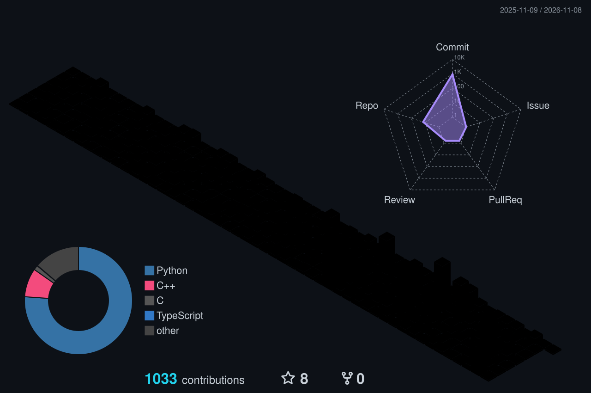

  
  <picture>
    <source media="(max-width: 600px)" srcset="https://raw.githubusercontent.com/ScaraMouche-Wanderer/ScaraMouche-Wanderer/main/assets/typing-mobile.svg" />
    
  </picture>

  <b>Electronics & communication · Embedded systems · Linux · Computer vision</b> 
  Building ESP32 firmware, native desktop apps, and local AI tools.

<h2 align="center">🐍 Contribution snake</h2>

  <picture>
    <source media="(prefers-color-scheme: dark)" srcset="https://raw.githubusercontent.com/ScaraMouche-Wanderer/ScaraMouche-Wanderer/output/snake-dark.svg" />
    <source media="(prefers-color-scheme: light)" srcset="https://raw.githubusercontent.com/ScaraMouche-Wanderer/ScaraMouche-Wanderer/output/snake.svg" />
    
  </picture>

<h2 align="center">🛠️ Featured builds</h2>

  
  

  
  

  

<a href="./PROJECTS.md">All projects & implementation guides ↗</a>

<b>🎬 See FaceGATE and CodeWriter running</b>

 

| FaceGATE Linux | CodeWriter |
| :---: | :---: |
|  |  |

The [IoT Firewall laptop demo](https://github.com/ScaraMouche-Wanderer/Iot-Firewall-main/blob/main/docs/PRESENTATION.md) runs without an ESP32 and labels its simulated telemetry.

<h2 align="center">🧰 Languages & tools</h2>

    
  

<h2 align="center">⚡ GitHub activity</h2>

  <picture>
    <source media="(prefers-color-scheme: dark)" srcset="https://raw.githubusercontent.com/ScaraMouche-Wanderer/ScaraMouche-Wanderer/output/stats-dark.svg" />
    <source media="(prefers-color-scheme: light)" srcset="https://raw.githubusercontent.com/ScaraMouche-Wanderer/ScaraMouche-Wanderer/output/stats-light.svg" />
    
  </picture>
  <picture>
    <source media="(prefers-color-scheme: dark)" srcset="https://raw.githubusercontent.com/ScaraMouche-Wanderer/ScaraMouche-Wanderer/output/languages-dark.svg" />
    <source media="(prefers-color-scheme: light)" srcset="https://raw.githubusercontent.com/ScaraMouche-Wanderer/ScaraMouche-Wanderer/output/languages-light.svg" />
    
  </picture>

  <picture>
    <source media="(prefers-color-scheme: dark)" srcset="https://raw.githubusercontent.com/ScaraMouche-Wanderer/ScaraMouche-Wanderer/output/streak-dark.svg" />
    <source media="(prefers-color-scheme: light)" srcset="https://raw.githubusercontent.com/ScaraMouche-Wanderer/ScaraMouche-Wanderer/output/streak-light.svg" />
    
  </picture>

<h2 align="center">🌃 My contributions in 3D</h2>

  

  Refreshes daily with GitHub Actions · <a href="./INTEGRATIONS.md">Integrations & credits</a>  
  

